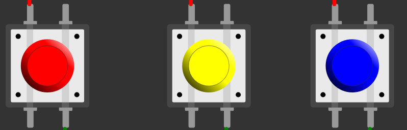
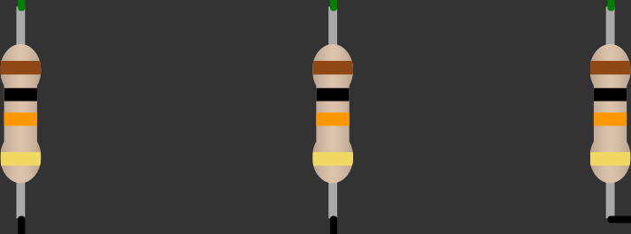
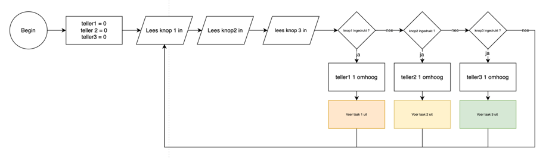
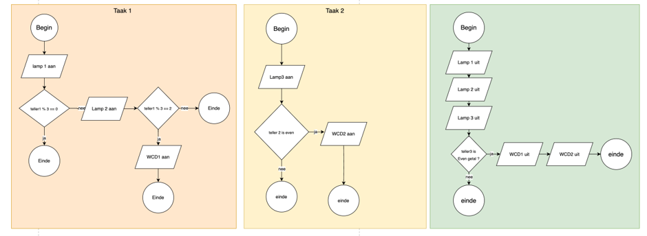

# 🏠 Domotica-opdracht – Raspberry Pi Pico

Een domotica-besturing met een **Raspberry Pi Pico**, drie drukknoppen en vijf relais. Met de knoppen worden drie lampen en twee wandcontactdozen (WCD's) aangestuurd.


---

## 📑 Inhoud

- [1. Projectbeschrijving](#-1-projectbeschrijving)
- [2. Werking van het programma](#-2-werking-van-het-programma)
- [3. Benodigde componenten](#-3-benodigde-componenten)
- [4. Aansluitingen](#-4-aansluitingen)
- [5. Foto's van de opstelling](#-5-fotos-van-de-opstelling)
- [6. Flowchart](#-6-flowchart)
- [7. Python-bestanden](#-7-python-bestanden)
- [8. Veiligheid](#-8-veiligheid)
- [9. Conclusie](#-9-conclusie)

## 💡 1. Projectbeschrijving

Het doel van deze opdracht is om een eenvoudige domotica-installatie te maken. De Raspberry Pi Pico leest drie drukknoppen uit. Afhankelijk van de ingedrukte knop voert het programma een taak uit en schakelt het één of meer relais.

De relais stellen in dit project twee wandcontactdozen en drie lampen voor:

- WCD 1
- WCD 2
- Lamp 1
- Lamp 2
- Lamp 3

**Maker:** `[vul je naam in]`  
**Klas:** `[vul je klas in]`  
**Datum:** `[vul de datum in]`

## ⚙️ 2. Werking van het programma

De Pico controleert voortdurend de drie drukknoppen. Zodra een knop wordt ingedrukt, wordt de bijbehorende teller verhoogd en wordt de bijbehorende taak uitgevoerd. De tellers zorgen ervoor dat het programma bepaalde relais op basis van het aantal drukken schakelt.

### Functie van de drukknoppen

| Drukknop | GPIO-pin | Taak |
|---|---:|---|
| 🔴 Rood | GP8 | Taak 1: Lamp 1, Lamp 2 en eventueel WCD 1 |
| 🟡 Geel | GP7 | Taak 2: Lamp 3 en eventueel WCD 2 |
| 🔵 Blauw | GP6 | Taak 3: Lampen uit en eventueel WCD's uit |

### Wat doen de taken?

**Taak 1 – Rode knop**
1. Lamp 1 wordt ingeschakeld.
2. Afhankelijk van teller 1 wordt ook Lamp 2 ingeschakeld.
3. Bij de tweede druk in de telcyclus wordt ook WCD 1 ingeschakeld.

**Taak 2 – Gele knop**
1. Lamp 3 wordt ingeschakeld.
2. Als teller 2 even is, wordt ook WCD 2 ingeschakeld.

**Taak 3 – Blauwe knop**
1. Lamp 1, Lamp 2 en Lamp 3 worden uitgeschakeld.
2. Als teller 3 even is, worden WCD 1 en WCD 2 uitgeschakeld.

> Deze uitleg beschrijft de bedoelde werking zoals die in de flowcharts en functies is uitgewerkt. Zie de codecontrole bij [Python-bestanden](#-7-python-bestanden): in de huidige bestanden staan een paar naamfouten die eerst moeten worden opgelost voordat `domotica.py` precies zo kan werken.

## 🧰 3. Benodigde componenten

| Component | Aantal | Gebruik |
|---|---:|---|
| Raspberry Pi Pico | 1 | Leest de knoppen en stuurt de relais aan |
| Drukknop (rood, geel, blauw) | 3 | Geeft opdrachten aan de Pico |
| Weerstand van 1 kΩ | 3 | Weerstanden in de Wokwi-schakeling |
| Relaismodule | 5 | Schakelt de twee WCD's en drie lampen |
| Jumperdraden | Meerdere | Maken de elektrische verbindingen |

### Afbeeldingen van componenten

**Drukknoppen**



**Weerstanden**



**Raspberry Pi Pico en relaismodules**

Deze onderdelen zijn zichtbaar op de Wokwi-opstelling bovenaan deze README. Voeg eventueel eigen foto's van de losse onderdelen toe aan de map `Images`.

### Waar kun je de onderdelen kopen?

De onderdelen zijn verkrijgbaar bij elektronicawinkels en webshops, bijvoorbeeld:

- [Kiwi Electronics](https://www.kiwi-electronics.com/) – zoek op *Raspberry Pi Pico*, *jumper wires* of *relaismodule*.
- [TinyTronics](https://www.tinytronics.nl/) – zoek op *drukknop*, *weerstand 1 kΩ* of *relaismodule*.

Controleer bij het bestellen altijd de juiste weerstandwaarde, voedingsspanning en compatibiliteit van de relaismodule met de Raspberry Pi Pico.

## 🔌 4. Aansluitingen

De onderstaande tabel is overgenomen uit het Wokwi-schema en `io_pico.py`.

### Drukknoppen

| Onderdeel | GPIO-pin Pico |
|---|---:|
| Rode drukknop | GP8 |
| Gele drukknop | GP7 |
| Blauwe drukknop | GP6 |

### Relais

| Relais | Aangestuurd onderdeel | GPIO-pin Pico |
|---|---|---:|
| Relais 1 | WCD 1 | GP28 |
| Relais 2 | WCD 2 | GP27 |
| Relais 3 | Lamp 1 | GP26 |
| Relais 4 | Lamp 2 | GP21 |
| Relais 5 | Lamp 3 | GP17 |

De drie weerstanden zijn in het Wokwi-diagram ingesteld op **1.000 Ω (1 kΩ)**. In de bedrading zijn de drukknoppen verbonden met VBUS en de GPIO-ingangen; de weerstanden zijn met GND verbonden.

## 📸 5. Foto's van de opstelling

### Wokwi-simulatie

Dit is de digitale schakeling met de Raspberry Pi Pico, drie drukknoppen en vijf relaismodules.


### Echte opstelling

Voeg hier een foto toe van de fysieke schakeling die je zelf hebt opgebouwd. Sla de foto op in de map `Images/Wokwi` met de naam `Echte-opstelling.jpg`.


*De foto van de echte opstelling moet nog worden toegevoegd.*

## 🔄 6. Flowchart

De eerste flowchart laat zien hoe het hoofdprogramma de knoppen uitleest en de juiste taak start.



De tweede flowchart laat zien wat de drie taken doen.



## 💻 7. Python-bestanden

De Python-code staat in de map `Python`.

| Bestand | Functie |
|---|---|
| `main.py` | Start op dit moment de testfunctie van de Pico |
| `domotica.py` | Bevat de bedoelde hoofdloop en de drie domotica-taken |
| `io_pico.py` | Verbindt de Python-functies met de GPIO-pinnen van de Pico |
| `io_comp.py` | Simuleert de invoer en uitgangen via de computer/terminal |
| `io_functies.py` | Bevat de opzet van de invoer- en uitvoerfuncties |

### Belangrijke controle van de huidige code

Er zijn twee punten om te controleren voordat de volledige domotica-besturing werkt:

1. `main.py` voert nu `io_pico.test_buttons()` uit. Daarmee test je de knoppen en relais; het start niet de taken uit `domotica.py`.
2. In `domotica.py` staan enkele schrijf-/naamfouten, bijvoorbeeld `tellerl` in plaats van `teller1`, `lampl` in plaats van `lamp1` en `wcdl` in plaats van `wcd1`. Ook moeten de functienamen consequent overeenkomen met die in `io_pico.py`.

Controleer en verbeter deze namen voordat je de taakbesturing uitvoert. De flowcharts beschrijven de bedoelde taakwerking.

## ⚠️ 8. Veiligheid

- Gebruik de Raspberry Pi Pico alleen met de juiste voedingsspanning.
- Controleer of de relaismodules geschikt zijn voor de gebruikte aansturing en voeding.
- Sluit netspanning niet rechtstreeks aan op de Pico.
- Werk voor tests bij voorkeur met veilige laagspanning.
- Laat eventuele aansluitingen op 230 V uitvoeren of controleren door een deskundige.

## ✅ 9. Conclusie

In deze opdracht wordt een domotica-schakeling gemaakt met een Raspberry Pi Pico. Drie drukknoppen geven opdrachten aan de Pico. De Pico stuurt vervolgens vijf relais aan die twee WCD's en drie lampen voorstellen.

Door de schakeling in Wokwi te simuleren en de code in verschillende bestanden op te delen, is te zien hoe invoer, programmalogica en hardware samenwerken.

**Wat heb ik geleerd?** `[Vul hier in wat je tijdens deze opdracht hebt geleerd en wat je eventueel de volgende keer zou verbeteren.]`

---

## 📁 Bestandsstructuur

```text
Domotica_Opdracht/
├── README.md
├── Diagram (Wokwi)/
│   └── Diagram.json.txt
├── Images/
│   ├── Drukknop/
│   │   └── Drukknoppen.png
│   ├── Flowchart/
│   │   ├── Flowchart1.png
│   │   └── Flowchart2.png
│   ├── Weerstand/
│   │   └── Weerstanden.png
│   └── Wokwi/
│       ├── Wokwi-opstelling.png
│       └── Echte-opstelling.jpg  ← zelf toevoegen
└── Python/
    ├── domotica.py
    ├── io_comp.py
    ├── io_functies.py
    ├── io_pico.py
    └── main.py
```
