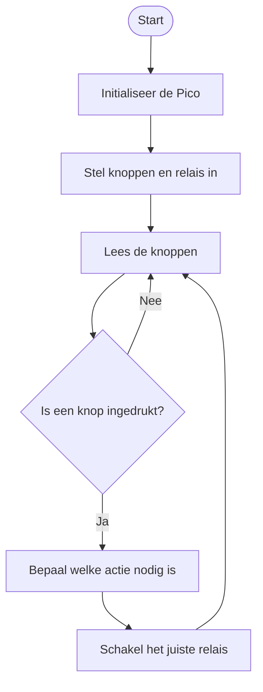

# 🏠 Domotica-project -- Raspberry Pi Pico

> Een korte uitleg van mijn domotica-project: een Raspberry Pi Pico die
> met drukknoppen vijf relaismodules aanstuurt.


------------------------------------------------------------------------

## Inhoud

-   [1. Over het project](#-1-over-het-project)
-   [2. Hoe werkt het?](#-2-hoe-werkt-het)
-   [3. Benodigdheden](#-3-benodigdheden)
-   [4. Aansluitschema](#-4-aansluitschema)
-   [5. Foto's](#-5-fotos)
-   [6. Flowchart](#-6-flowchart)
-   [7. Programmacode](#-7-programmacode)
-   [8. Conclusie](#-8-conclusie)

## 1. Over het project

**Naam:** Domotica met Raspberry Pi Pico\
**Maker:** `[vul je naam in]`\
**Klas:** `[vul je klas in]`\
**Datum:** `[vul de datum in]`

### Doel

Beschrijf hier in een paar zinnen wat je hebt gebouwd en wat het doel
van de opdracht is.

## 2. Hoe werkt het?

Beschrijf hier stap voor stap wat de code doet.

1.  De Raspberry Pi Pico start op.
2.  De Pico stelt de knoppen en relais in.
3.  De Pico controleert of er een knop wordt ingedrukt.
4.  De code bepaalt welk relais moet schakelen.
5.  De Pico herhaalt dit proces.

**Functie van de knoppen en relais**

  Onderdeel        Functie
  ---------------- --------------------------------
  🔴 Rode knop     `[beschrijf de functie]`
  🟡 Gele knop     `[beschrijf de functie]`
  🔵 Blauwe knop   `[beschrijf de functie]`
  Relais 1         `[beschrijf wat het schakelt]`
  Relais 2         `[beschrijf wat het schakelt]`
  Relais 3         `[beschrijf wat het schakelt]`
  Relais 4         `[beschrijf wat het schakelt]`
  Relais 5         `[beschrijf wat het schakelt]`

## 3. Benodigdheden

  ------------------------------------------------------------------------------------
  Component                       Aantal Waarvoor gebruik   Link
                                         je het?            
  ---------------- --------------------- ------------------ --------------------------
  Raspberry Pi                         1 Bestuurt de        [Productlink](PLAK_LINK)
  Pico                                   schakeling         

  Drukknop                             3 Geeft invoer aan   [Productlink](PLAK_LINK)
                                         de Pico            

  Weerstand                            3 Onderdeel van de   [Productlink](PLAK_LINK)
                                         knop-aansluiting   

  Relaismodule                         5 Schakelt een       [Productlink](PLAK_LINK)
                                         aangesloten        
                                         apparaat           

  Jumperdraden             Naar behoefte Verbindt de        [Productlink](PLAK_LINK)
                                         onderdelen         
  ------------------------------------------------------------------------------------

*Voeg eventueel per component een foto toe in de map `afbeeldingen`.*

## 4. Aansluitschema

Plaats hier de Wokwi-afbeelding:


### Gebruikte GPIO-pinnen

  Onderdeel     GPIO-pin
  ------------- -----------------
  Rode knop     `[GPIO-nummer]`
  Gele knop     `[GPIO-nummer]`
  Blauwe knop   `[GPIO-nummer]`
  Relais 1      `[GPIO-nummer]`
  Relais 2      `[GPIO-nummer]`
  Relais 3      `[GPIO-nummer]`
  Relais 4      `[GPIO-nummer]`
  Relais 5      `[GPIO-nummer]`

## 5. Foto's

### Simulatie in Wokwi


## 6. Flowchart

Plaats hieronder je flowchart. Je kunt bijvoorbeeld een afbeelding
gebruiken:


Of maak de flowchart rechtstreeks in Markdown met Mermaid:



**Let op:** pas de flowchart aan zodat deze overeenkomt met jouw eigen
programmacode.

## 7. Programmacode

De code staat in het bestand `main.py`.

Beschrijf hier eventueel belangrijke onderdelen van je code, zoals: -
Welke GPIO-pinnen je gebruikt. - Hoe je de drukknoppen uitleest. - Hoe
je de relais aan- en uitschakelt.

## 8. Conclusie

Beschrijf kort: - Wat werkt er goed? - Wat vond je lastig? - Wat heb je
geleerd? - Wat zou je de volgende keer verbeteren?

------------------------------------------------------------------------

## Bestandsindeling

Zorg dat je GitHub-project er ongeveer zo uitziet:

``` text
domotica-project/
├── README.md
├── main.py
└── afbeeldingen/
    ├── wokwi-opstelling.png
    ├── echte-opstelling.jpg
    ├── flowchart.png
    └── componenten/
        ├── raspberry-pi-pico.jpg
        ├── drukknop.jpg
        └── relaismodule.jpg
```

> **Tip:** gebruik duidelijke bestandsnamen en zet alle afbeeldingen in
> de map `afbeeldingen`. Dan blijven je projectbestanden overzichtelijk.
